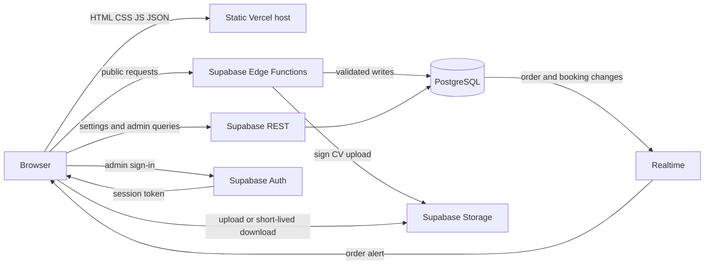

# How requests move through the site

## How it works

1. The host serves static pages and public configuration. The browser runs the code.
2. The storefront calls the menu endpoint and public settings view. It can display local samples if the live catalog cannot be loaded.
3. A submit request crosses into the appropriate Edge Function. An order request includes item IDs and quantities. The server reads the catalog to calculate the price and writes a pending order.
4. Auth returns a JWT on admin sign-in. A JWT is a signed token carrying an account identity and an expiry time. Supabase checks that token on admin requests to identify the caller.
5. Row-level security, or RLS, is a PostgreSQL feature that filters rows and write permissions for a caller. It protects records even when someone calls the database API outside the admin page.
6. A signed URL gives time-limited permission for a specific Storage operation. The CV upload link allows an applicant to upload to the generated path, and the admin download link grants short-lived read access.
7. Realtime delivers database changes to subscribed browsers. The Orders page listens for new order inserts and displays an alert.

Cross-Origin Resource Sharing, or CORS, tells a browser which website origins may read responses from another origin. The function checks the request origin against the configured list, while database permissions and input validation handle separate concerns.

## Where to look

`publicSupabase` in `js/support.js`, `start` and `access` in `admin/js/app.js`, `cors` in `supabase/functions/_shared/http.ts`, and the publication and RLS statements in migration 004. The operator reports Vercel serves the main branch. That routing was not verified during this task.
