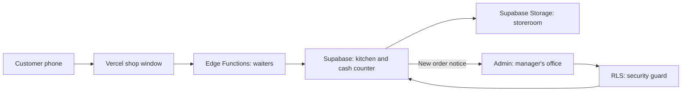

# A one-page map of the project

## What this part does

The shop window shows the menu. Waiters carry requests to the kitchen. The manager's office sees the resulting tickets according to the security guard's list.

## How it works, step by step

1. Vercel serves the customer pages and the manager's office. It is the shop window, a service that serves the files that make up the website.
2. The phone calls an API, an address where software can ask for information or send it. The menu API returns JSON, a text format for named values and lists. Think of `{"quantity":2}` as a tiny written order.
3. Supabase stores café records in a database, a collection of organised information. A table is like one Excel sheet. A row is one entry, such as one order. A column is one detail on that row, such as its total.
4. Row Level Security (RLS) checks which rows a caller can see or change. It is the guard with a list. An anonymous customer can see available dishes and cannot read the kitchen tickets.
5. The office subscribes to Realtime, a way to receive notices when a record changes. `render` in `admin/js/orders.js` reacts to new order inserts.

## Which files are involved

| File | What it does in simple words |
|---|---|
| `vercel.json` | Directs the short staff address to the office. |
| `js/support.js` | Sends browser requests through publicSupabase. |
| `supabase/functions/orders/index.ts` | Checks and saves an order. |
| `supabase/migrations/004_admin_rls_storage_realtime.sql` | Defines permissions and publishes selected tables. |
| `admin/js/orders.js` | Offers actions and listens for order notices. |

## What can go wrong and what to check

When something fails, locate the layer. A visible window proves the page loaded. A failed order may still come from a waiter, the kitchen records, or the guard's permissions.

## Try it yourself

Trace the arrows below with your finger. Then find the menu request in `loadMenu`.

## Project map

[Database sheets](06-database.md) · [Click-by-click walkthrough](05-flows.md) · [All files](03-file-guide.md)
